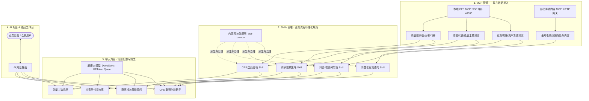

# AgenticCPS AI 模块核心功能操作说明：MCP、Skills 与 聊天角色

本指南全面梳理了 AgenticCPS 系统中 **MCP (Model Context Protocol)**、**Skills (业务技能)** 以及 **聊天角色 (Chat Roles)** 的底层架构逻辑与全流程操作指引，帮助运营与开发人员快速搭建、治理并使用业务智能体。

---

## 一、核心架构与协同关系

在 AgenticCPS 中，MCP、Skills 与 聊天角色构成了自底向上支撑智能体业务闭环的三层结构：

- **MCP 服务 (Model Context Protocol)**：底层标准协议工具提供者。对接本地或远程系统的原生 API，并暴露标准化的工具（Tools）。
- **Skills (业务技能)**：基于系统内置元技能 `skill-creator` 派生的业务流程规范包。它将一个或多个 MCP 工具、系统提示词、输入契约和风控边界组合在一起，形成可复用的场景化能力。
- **聊天角色 (Chat Roles)**：业务智能体实体。它组合了底座大模型、角色设定 (System Message)、一个或多个绑定的 Skills、MCP 权限策略与知识库，直接面向用户交互。

---

## 二、第一步：MCP 服务管理与工具配置

MCP 服务是整个 AI 体系调用业务系统功能的桥梁。

### 1. 界面入口
点击管理系统左侧主菜单：**AI 大模型 -> MCP 管理**。

### 2. 核心板块与功能
- **服务注册**：统一维护 MCP 服务的连接地址、通信协议、健康状态与运行开关。
- **工具目录**：查看并治理所有从 MCP 服务同步过来的工具清单，配置单个工具的安全风险等级。
- **权限策略**：按租户或应用设置工具调用的调用频次和白名单。
- **调用日志**：完整追溯每一次工具调用的上下文、请求入参、返回结果和耗时。

### 3. 具体操作流程
1. **健康检查与连通性验证**：
   - 列表中默认包含系统内置服务：
     - **本地 CPS MCP**（编码 `cps`，位置 `LOCAL`，协议 `SSE`，Endpoint 为 `http://127.0.0.1:48080/sse`）；
     - **海纳商品与内容 MCP**（编码 `haina`，位置 `REMOTE`，协议 `STREAMABLE_HTTP`）。
   - 查看“健康状态”列是否为绿色 `UP` 徽标。
   - 点击操作列的 **测试** 按钮，系统会发送 ping 探测，提示连接正常即代表可用。
2. **注册新 MCP 服务（可选）**：
   - 若需接入外部自建或第三方 MCP Server，点击右上角 **+ 注册服务**。
   - 填写服务编码、名称、选择传输协议（SSE 或 Streamable HTTP）并填入 Endpoint 地址后保存。
3. **同步工具目录**：
   - 当后端服务新增或更新了工具方法时，点击对应服务行的 **同步工具** 按钮。
   - 系统将自动向 MCP 节点发送握手请求，并将解析出的最新 Tools 列表同步入库。
4. **工具风险等级配置**：
   - 切换到 **工具目录** Tab，找到具体工具行。
   - 为工具配置合理的风险等级：
     - `READ_ONLY`：只读操作（如商品查询、价格对比、返利看板查询），无需审批；
     - `ATTRIBUTION_WRITE`：归因写入（如生成推广转链、绑定渠道关系）；
     - `ASSET_WRITE`：资产变更（如返利扣减、资金提现、Token 兑换），在 AI 执行时系统会强制要求审批确认；
     - `ADMIN`：系统管理级能力。

---

## 三、第二步：Skills 技能治理与能力绑定

Skills 将底层的零散工具封装为高聚合、带业务规则的技能包。

### 1. 界面入口
点击管理系统左侧主菜单：**AI 大模型 -> Skills 管理**。

### 2. 核心机制：内置 skill-creator 规范
- 系统原生预置元基座技能 `skill-creator`（编码：`skill-creator`，内置基座）。
- 所有业务 Skill（如 `douyin-commerce`、`wechat-video-commerce`、`cps-selection` 等）均继承自该规范，确保每个技能都拥有清晰的业务目标、标准提示词模板、输入契约与安全等级。

### 3. 新建与发布业务 Skill 操作步骤
1. **启动新建向导**：
   - 点击页面右上角 **新建 Skill** 按钮，弹出配置抽屉。
2. **基于 AI 生成规范草案（推荐）**：
   - 在“业务目标说明”输入框中，输入自然语言业务描述（例如：*“围绕多平台高佣商品搜索、比价并生成选品建议”*）。
   - 勾选“使用 AI 模型增强生成”，点击 **基于内置 skill-creator 生成规范草案**。
   - 系统将自动分析目标，一键填充符合规范的系统提示词、输入契约和推荐绑定的能力。
3. **核对与微调属性**：
   - **名称**：例如 `CPS 选品分析`。
   - **编码**：英文唯一编码，如 `cps-selection`。
   - **分类**：如 `CPS`、`SYSTEM` 等。
   - **适用渠道**：选择或输入适用渠道（如 `ALL`、`DOUYIN`、`WECHAT_VIDEO`、`MALL`）。
   - **风险等级**：选择该技能的最高风险等级（不能低于所依赖工具的最高等级）。
4. **绑定 MCP 能力与底层工具**：
   - 在能力绑定区域中，选择关联的 MCP 服务（如 `本地 CPS MCP`）。
   - 选择该服务下暴露的对应工具（如 `cps_search_goods`、`cps_compare_prices` 等）。
   - 也可同时关联知识库与本地工具。
5. **版本发布（关键步骤）**：
   - 新建的 Skill 保存后处于 `v1 (待发布 / 草稿)` 状态。
   - 点击列表对应 Skill 行的 **版本与发布**，进入版本管理弹窗。
   - 审核初始版本的契约内容后，点击 **发布** 按钮。
   - 状态变为绿色 `v1 PUBLISHED` 标签后，该技能才正式生效并可供聊天角色关联调用。

---

## 四、第三步：配置业务聊天角色 (Chat Role)

聊天角色是用户最终交互的数字员工，负责把大模型、提示词设定、Skills 技能和 MCP 服务封装为一个具体的执行角色。

### 1. 界面入口
点击管理系统左侧主菜单：**AI 大模型 -> 控制台 -> 聊天角色**。

### 2. 预设角色体系
系统已预置丰富的电商 CPS 场景角色，开箱即用：
- **流量主选品官** (`traffic-promoter`)：专注于各平台高佣、爆品选拔与比价，绑定选品 Skill。
- **商家投放策略顾问** (`merchant-ad-planner`)：提供商家定向引流与高回报投放方案。
- **消费者返利管家** (`consumer-rebate-assistant`)：查询订单收益与返利明细。
- **视频号 / 抖音号带货助手**：专为对应社交电商平台优化的带货文案与商品链策略。
- **CPS 联盟全能助手**：集成 24 项全量工具与资产级权限的综合后台专家。

### 3. 新建或编辑角色流程
1. 点击右上角 **+ 新增** 或在目标角色行点击 **编辑**。
2. **基础画像设置**：
   - **角色名称**：定义直观的人设名称（如：*年货节高佣选品顾问*）。
   - **角色头像**：上传或选择代表性图标。
   - **角色类别**：输入分类（如 `CPS 联盟`）。
   - **预设编码**：如 `cps-selection-officer`。
   - **适用渠道与人群**：指定适用场景（通用/视频号/抖音/商城等）及受众（后台运营/会员/商家）。
3. **选择底座大模型**：
   - 在“绑定模型”下拉框选择实际调用的底层大模型（如已接入的 gpt-4o、DeepSeek-V3、通义千问等）。
4. **设定人设提示词 (System Message)**：
   - 编写角色设定。例如：*“你是专业的 CPS 电商选品分析师，善于结合佣金率、券后价与历史销量为运营人员提供最佳选品组合……”*。
5. **核心集成（关联 MCP 与 Skills）**：
   - **引用 MCP**：多选勾选当前角色需要访问的 MCP 客户端服务（如 `cps`、`haina`）。
   - **MCP 策略**：关联已配置的 MCP 安全与调用限额策略。
   - **绑定 Skills**：多选勾选第二步中已发布的业务技能（如 `CPS 选品分析`、`抖音号带货`）。绑定后，模型会自动装配这些技能的专业业务规则。
   - **引用知识库 / 工具**：如需辅助文档或本地工具，可在此追加勾选。
6. **风控与权限**：
   - **风险等级**：选择该角色允许执行的操作级别（READ_ONLY / ATTRIBUTION_WRITE / ASSET_WRITE）。
   - **是否公开 / 会员可用**：若勾选“会员可用”，则移动端/商城端用户也可与其对话；否则仅限管理后台运营人员。
   - **开启状态**：切换为开启。点击保存完成角色装配。

---

## 五、第四步：在 AI 对话中实战体验

完成 MCP 注册、Skill 封装和角色组装后，即可在对话界面进行实战检验。

### 1. 界面入口
点击管理系统左侧主菜单：**AI 大模型 -> AI 对话**。

### 2. 发起会话与选用角色
1. **新建或进入会话**：
   - 点击左侧列表中的 **+ 新建对话**，或直接点击预置的 **CPS 自测会话**。
2. **选择目标角色**：
   - 在中间提示区域点击 **选择聊天角色后开始**（或在输入框左下角点击“角色仓库”）。
   - 选择刚才配置好的业务角色（例如“流量主选品官”）。
3. **核对生效能力快照（Capability Tag Bar）**：
   - 会话创建后，对话窗口顶部将自动展示当前生效的能力标签条：
     - `角色编码 · 版本`
     - `Skill · 技能编码 v版本`
     - `MCP · 服务名称 (可用工具数)`
     - `风险级别`（如 READ_ONLY 或 ATTRIBUTION_WRITE）
   - 这代表底层 MCP 工具与 Skills 已成功动态装载，随时待命。

### 3. 进行业务交互与工具调用
1. **输入业务诉求**：
   - 在底部输入框输入真实业务问题，例如：
     > *“帮我查一下今天淘宝和拼多多上关于夏季防晒衣的高佣爆款商品，对比佣金率，并给出选品推荐”*
2. **观察自动化工具调用流**：
   - 智能体会自动根据角色绑定的 Skill 与 MCP 服务，分解任务并调用底层工具（如 `cps_search_goods` 检索商品、`cps_compare_prices` 进行价格和佣金比对）。
   - 消息列表中会实时呈现 **Tool Execution（工具执行步骤）**，展示调用的服务来源、函数名、入参数据与响应结果。
3. **CPS 选品工作台协同 (Workbench)**：
   - 对话顶部集成的 **CPS 选品工作台** 会根据工具返回的结构化商品数据，自动组织为可视化对比卡片，支持一键加入选品库或生成推广转链。
4. **安全确认卡片 (Tool Confirmation Cards)**：
   - 如果用户要求执行高风险写操作（如 *“把这批选品一键转链并写入推广位”* 或 *“执行返利冻结”*），系统会拦截请求并弹出人机协同审批卡片，管理员审核参数无误后点击“确认执行”，才会最终生效并落库。

---

## 六、全链路排错与最佳实践速查表

| 环节 | 常见排错现象 | 原因分析与解决建议 |
| :--- | :--- | :--- |
| **MCP 服务** | 服务状态显示 `DOWN` 或测试失败 | 检查 Endpoint 端口（本地默认 48080）与防火墙；检查后台服务是否已正常启动 SSE/HTTP 端点。 |
| **MCP 工具** | 同步工具提示成功但列表为空 | 确认 MCP 服务端是否实现了标准的 `tools/list` 协议，并检查鉴权 Token 或请求头配置。 |
| **Skills 技能** | 角色无法绑定新建的 Skill | **新建的 Skill 必须经过发布步骤！** 在 Skills 列表操作栏点击“版本与发布”，将初始 v1 草稿审核发布（变为 PUBLISHED）后方可被角色检索绑定。 |
| **风控拦截** | 角色调用工具提示 `Permission Denied` / 权限超限 | **风险等级对齐原则**：角色的风险等级不能低于其绑定的 Skill 或引用的 MCP 工具风险等级。例如工具需要 `ATTRIBUTION_WRITE`，则角色不能设置为 `READ_ONLY`。 |
| **AI 对话** | 提问后模型没有调用工具，仅文字回复 | 检查对话顶部能力快照是否正确显示 MCP 工具数量；若工具数为 0，说明角色未正确勾选 MCP 客户端或绑定的 Skill 尚未生效。 |
