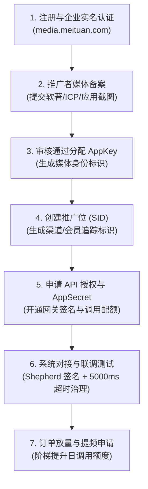

# 美团联盟（美团开放平台）官方 API 接入与资质申请指南

本文档依据美团开放平台（美团联盟媒体平台 `media.meituan.com`）官方开发者接入规范、Shepherd API Gateway 网关鉴权标准及业务审核要求编写。涵盖**企业入驻资质要求**、**媒体备案与 API 权限申请流程**、**Shepherd 签名网关机制**、**核心 API 规范与数据映射**、**AgenticCPS 工程实现**以及**后台配置与避坑指南**。

---

## 一、 美团联盟开放平台生态与架构概述

美团联盟（`media.meituan.com`）是美团官方推出的 CPS（Cost Per Sales）推广与流量变现合作平台，覆盖外卖、闪购、优选、到店餐饮、酒旅休闲等本地生活全场景。开发者或媒体主通过 API 接入，可实现卡券选品、自动化转链、多端唤起（App/H5/小程序）、订单自动同步与佣金结算。

美团开放接口统一经由 **Shepherd API Gateway** 进行安全分发与鉴权：

```
                       ┌─────────────────────────┐
                       │   美团开放平台 API 网关   │
                       │   (Shepherd API Gateway)│
                       │   openapi.meituan.com   │
                       └────────────┬────────────┘
                                    │ Shepherd Header 签名 (HMAC-SHA256)
                                    ▼
                       ┌─────────────────────────┐
                       │   AgenticCPS 后端服务    │
                       │(MeituanOfficialVendorClient)
                       └────────────┬────────────┘
                                    │ 统一平台抽象 (CpsPlatformClientAdapter)
                                    ▼
┌──────────────────┐  ┌──────────────────┐  ┌──────────────────┐
│  卡券与商品选品   │  │   推广转链与口令   │  │   订单同步与归因   │
│  (searchGoods)   │  │(generatePromotion)│  │  (queryOrders)   │
│  /query_coupon   │  │/get_referral_link │  │   /query_order   │
└──────────────────┘  └──────────────────┘  └──────────────────┘
```

---

## 二、 申请入驻与企业资质要求

根据美团联盟官方媒体接入管理办法与安全合规规范，申请开通 API Gateway 高级调用权限必须满足以下主体资质与媒体资产要求：

### 1. 基础主体资质
* **企业法人主体**：
  * 仅支持中国大陆合法注册的**企业法人**主体（个体工商户通常无法开通 API 自动化转链与订单同步权限）。
  * 营业执照须为“三证合一”正本/副本清晰彩色扫描件，经营范围建议包含“技术开发、软件服务、互联网信息服务、广告营销、电子商务”等技术或商业服务类目。
  * 企业经营状态正常，未被市场监督管理部门列入“经营异常名录”或“严重违法失信名单”。
* **法定代表人与经办人认证**：
  * 法人身份证正反面彩色扫描件（须在有效期内）。
  * 经办人实名手机号（需绑定实名认证的美团个人账号），用于后台操作验证及安全通知。
* **财务与对公结算资质**：
  * 企业对公银行账户信息（开户行名称、开户账号、银行印鉴/开户许可证）。平台在企业认证时可能采用对公小额打款核验真实性。
  * 具备合规开票纳税人资质（增值税专用发票或普通发票），每月结算 CPS 推广佣金时需开具等额技术服务发票。

### 2. 媒体资产与合规硬性资质
申请美团联盟“媒体备案”与“API 权限”时，必须提供已上线运营的真实媒体资产证明（按实际推广载体提供相应材料）：

* **自有 App 场景**：
  * **计算机软件著作权登记证书（软著）**：由国家版权局颁发，证书著作权人必须与美团入驻企业主体**完全一致**。
  * **应用商店上架证明**：提供主流应用商店（如 Apple App Store、华为、小米、应用宝等）的上架在架截图及有效下载链接。
  * **App ICP 备案号**：符合工信部移动互联网应用程序（App）备案要求。
* **微信小程序 / 微信公众号**：
  * 微信公众平台后台认证截图（主体名称与入驻企业完全一致）。
  * 小程序 AppID、上线版本截图，展示导购、卡券领取或返利落地页的真实场景。
* **Web / H5 网站**：
  * 工信部 ICP 备案证书/查询截图（域名持有企业与入驻主体一致，不支持个人备案域名接入企业应用）。
  * 网站须全面支持 HTTPS 安全通信协议，提供线上选品与活动展示页面截图。
* **社群 / 私域流量矩阵**：
  * 提供社群体量证明（如企业微信用户数、社群数量截图）。
  * 签署《合规推广承诺书》，严禁使用恶意劫持剪贴板、诱导分享、虚假价格承诺等违规手段。

---

## 三、 入驻申请与 API 权限开通流程步骤



### 步骤 1：注册与企业认证
1. 访问 [美团联盟媒体平台](https://media.meituan.com)，使用手机号注册美团联盟账号。
2. 进入【账户设置】->【实名认证】，选择“企业认证”，上传营业执照、法人身份证件并填写对公账户信息，等待平台人工审核（通常 1~2 个工作日）。

### 步骤 2：推广者媒体备案（获取 AppKey）
1. 登录平台后台，进入**【推广者备案】->【媒体管理】**，点击【新增媒体】。
2. 填写媒体名称、媒体类型（App / 小程序 / 网站 / 社交私域）、媒体 URL / AppID。
3. 上传软著扫描件、ICP 备案证明及产品功能截图。
4. 平台审核通过后，该媒体记录将生成唯一的 **`AppKey`**（用于 API 调用的网关身份标识）。

### 步骤 3：创建推广位（获取默认 SID）
1. 进入**【推广者备案】->【推广位管理】**，点击【新增推广位】。
2. 选择所属媒体，创建推广位名称（如“通用默认位”），系统生成推广位标识 **`SID`**。
3. `SID` 支持最长 32 位（仅限字母、数字、下划线），后续可作为默认推广位或按渠道细分。

### 步骤 4：开通 API 授权（获取 AppSecret）
1. 进入**【我要推广】->【API 授权】**页面，点击【去开通】。
2. 选择已备案通过的媒体，提交 API 使用场景说明（如“选品返利系统、商品搜索与订单对账”）。
3. 审核通过后，即可在后台查看配套的 **`AppSecret`**（用于 Shepherd 网关签名生成，需严密保密）。
4. 系统默认分配基础调用频次（通常为 2,000 ~ 5,000 次/天）。后续当平台月均产生有效订单后，可根据后台提示提交**提频申请**，可提升至 50,000 ~ 500,000 次/天。
5. （可选）在后台配置订单状态变更回调 URL（Webhook），接收订单核销与结算推送。

---

## 四、 核心 API 接口清单

AgenticCPS 现已完成美团联盟三大核心场景的官方接口标准化集成：

| 业务场景 | 接口路径 (Path) | 请求方式 | 对应系统客户端方法 | 说明 |
| :--- | :--- | :--- | :--- | :--- |
| **卡券/商品选品** | `/cps_open/common/api/v1/query_coupon` | POST | `searchGoods(...)` | 检索外卖、闪购、优选、到店卡券与优惠活动商品 |
| **推广转链获取** | `/cps_open/common/api/v1/get_referral_link` | POST | `generatePromotionLink(...)` | 将物料 ID、卡券或商品生成专属推广长短链、唤端 Deeplink 与小程序路径 |
| **推广订单同步** | `/cps_open/common/api/v1/query_order` | POST | `queryOrderPage(...)` / `queryOrders(...)` | 按付款时间或更新时间拉取联盟分销订单明细 |

---

## 五、 Shepherd 网关通信规范与签名算法 (HMAC-SHA256)

### 1. 网关与请求头规范
* **生产网关 BaseUrl**：`https://openapi.meituan.com`（或 `https://media.meituan.com/cps_open/common/api/v1`）
* **字符编码**：`UTF-8`
* **Content-Type**：`application/json; charset=utf-8`

每次请求必须在 HTTP Header 中携带 Shepherd 网关认证参数：

| 标头名称 | 类型 | 是否必选 | 说明 |
| :--- | :--- | :---: | :--- |
| `Accept` | String | 是 | 固定为 `application/json; charset=utf-8` |
| `Content-Type` | String | 是 | 固定为 `application/json; charset=utf-8` |
| `Content-MD5` | String | 是 | 请求体（Body）UTF-8 字节进行 MD5 摘要后的 Base64 编码字符串 |
| `S-Ca-App` | String | 是 | 美团联盟媒体分配的 `AppKey` |
| `S-Ca-Timestamp` | String | 是 | 当前系统毫秒时间戳字符串（`System.currentTimeMillis()`） |
| `S-Ca-Signature-Headers` | String | 是 | 参与签名的自定义 Header 名称（转小写后字典序排序，逗号分隔，固定为 `s-ca-app,s-ca-timestamp`） |
| `S-Ca-Signature` | String | 是 | 签名计算结果（HMAC-SHA256 Base64 编码字符串） |

### 2. 签名计算公式

待签名字符串（`StringToSign`）格式：

$$\text{StringToSign} = \text{HTTP\_METHOD} + \text{"\textbackslash n"} + \text{Content-MD5} + \text{"\textbackslash n"} + \text{Headers} + \text{Resource}$$

1. **HTTP_METHOD**：统一大写，如 `POST` 或 `GET`。
2. **Content-MD5**：请求体 Body 的 MD5 字节摘要的 Base64 字符串（无 Body 时为 `""`）。
3. **Headers**：对 `S-Ca-Signature-Headers` 中列出的标头，按小写字母升序排列，逐行格式化为 `key + ":" + value + "\n"`：
   ```text
   s-ca-app:YOUR_APP_KEY\n
   s-ca-timestamp:1730000000000\n
   ```
4. **Resource**：规范化 URI 路径（以 `/` 开头，如 `/cps_open/common/api/v1/query_coupon`）。若存在 URL Query 参数，按参数名 ASCII 升序排列并以 `?k1=v1&k2=v2` 拼接待签名串尾部。
5. **HMAC-SHA256 计算**：以 `AppSecret` 的 UTF-8 字节为密钥，对 `StringToSign` 计算 HMAC-SHA256，再进行 Base64 编码得到 `S-Ca-Signature`。

---

## 六、 接口入参与响应模型映射

### 1. 推广转链 (`/cps_open/common/api/v1/get_referral_link`)

美团转链核心规则要求：**活动物料ID (`actId`)**、**商品加密标识 (`productViewSign`)**、**目标链接或内容 (`text`)** 三者必须且仅能提供其中之一（**“三选一”互斥规则**）：

```json
{
  "platform": 1,
  "bizLine": 1,
  "linkType": 1,
  "actId": 33,
  "sid": "SID_ABC12345678"
}
```

* **互斥参数逻辑**：
  * 请求中存在 `itemLink` 或 `http(s)://` 时映射至 `text`；
  * 请求包含 `act:` 或数字活动 ID 时映射至整数型 `actId`；
  * 包含商品识别号时映射至 `productViewSign`。
* **渠道追踪与会员归因 (`sid`)**：
  * `sid` 最长 32 位，仅允许字母、数字和下划线。
  * AgenticCPS 系统在会员推广场景下生成 15 位紧凑不透明标识（`CpsTransferRecordDO`），订单拉取后通过 `sid` 精确自动绑定会员资产，防止伪造。
* **响应转链解析 (`referralLinkMap`)**：
  * `"1"` -> 推广 H5 长链接 (`longUrl`)
  * `"2"` -> 推广短链接 (`shortUrl`，系统优先展示)
  * `"3"` -> 唤端 Deeplink (`mobileUrl` / `deeplink`)
  * `"4"` -> 微信小程序跳转路径 (`miniProgramPath`)
  * `"5"` -> 美团团口令 (`tpwd`)

### 2. 卡券/商品查询 (`/cps_open/common/api/v1/query_coupon`)

* **入参规范**：
  * `bizLine`：业务线（1: 外卖, 2: 闪购, 3: 优选, 4: 到店/到餐，默认 1）
  * `platform`：终端类型（1: PC, 2: H5, 3: Android, 4: iOS, 5: 微信小程序，默认 1）
  * `page`、`pageSize`：分页参数
  * `couponType`、`cityId`：可选地域与类型过滤
* **出参标准化转换**：
  * `couponId` -> `goodsId`
  * `couponName` -> `goodsName`
  * `couponAmount` -> `couponAmount`
  * `originalPrice` -> `originPrice`
  * `couponPrice` -> `actualPrice`
  * `commissionRatio` (百分比) -> `commissionRate` (小数标准化)

### 3. 订单同步 (`/cps_open/common/api/v1/query_order`)

* **查询维度**：
  * `type`：1 按支付时间，2 按更新时间（增量对账使用 2）
  * `businessLine`：业务线标识，逗号分隔（如 `"1,2,3"`）
  * `tradeType`：订单结算交易类型，逗号分隔（如 `"1,2"`）
* **订单状态机转换**：
  * 状态 `1` (已付款) -> `PAID`
  * 状态 `2` (已收货/已核销) -> `RECEIVED`
  * 状态 `3` (已结算) -> `SETTLED`
  * 状态 `4` (已失效/退款) -> `REFUNDED`

---

## 七、 系统工程实现与质量门禁

AgenticCPS 已完成美团官方平台的完整生产级适配：

1. **Shepherd 签名网关算法**：
   [`MeituanApiGatewaySigner.java`](file:///backend/qiji-module-cps/qiji-module-cps-biz/src/main/java/com/qiji/cps/module/cps/client/official/meituan/MeituanApiGatewaySigner.java)
   * 严格实现 Base64-MD5、字典序 Header 规范化、Resource 规范化与 HMAC-SHA256 签名。
2. **美团官方供应商客户端**：
   [`MeituanOfficialVendorClient.java`](file:///backend/qiji-module-cps/qiji-module-cps-biz/src/main/java/com/qiji/cps/module/cps/client/official/meituan/MeituanOfficialVendorClient.java)
   * 构造器注入复用 `HttpClient` 连接池。
   * 声明全套供应商治理策略（5000ms 超时控制、120次/分并发限流、断路器熔断降级）。
   * 具备 `GOODS_SEARCH`, `PROMOTION_LINK`, `ORDER_QUERY`, `CONNECTION_TEST` 核心能力。
3. **平台适配器门面**：
   [`MeituanPlatformClientAdapter.java`](file:///backend/qiji-module-cps/qiji-module-cps-biz/src/main/java/com/qiji/cps/module/cps/client/meituan/MeituanPlatformClientAdapter.java)
   * 采用统一委托模式，通过 `CpsPlatformClientFactory` 动态路由至官方激活客户端。
4. **活动中心转链与归因支持**：
   [`CpsRebateActivityServiceImpl.java`](file:///backend/qiji-module-cps/qiji-module-cps-biz/src/main/java/com/qiji/cps/module/cps/service/activity/CpsRebateActivityServiceImpl.java)
   * 扩展 `PLATFORM_MEITUAN` 与 `SOURCE_OFFICIAL`，自动生成安全 15 位 SID 跟踪记录并完成多端推广物料组装。
5. **自动化测试套件（56/56 用例全量通过）**：
   * [`MeituanApiGatewaySignerTest`](file:///backend/qiji-module-cps/qiji-module-cps-biz/src/test/java/com/qiji/cps/module/cps/client/official/meituan/MeituanApiGatewaySignerTest.java)：2 测试用例
   * [`MeituanOfficialVendorClientTest`](file:///backend/qiji-module-cps/qiji-module-cps-biz/src/test/java/com/qiji/cps/module/cps/client/official/meituan/MeituanOfficialVendorClientTest.java)：12 测试用例
   * [`MeituanPlatformClientAdapterTest`](file:///backend/qiji-module-cps/qiji-module-cps-biz/src/test/java/com/qiji/cps/module/cps/client/meituan/MeituanPlatformClientAdapterTest.java)：7 测试用例
   * [`CpsSdkStandardizationContractTest`](file:///backend/qiji-module-cps/qiji-module-cps-biz/src/test/java/com/qiji/cps/module/cps/client/CpsSdkStandardizationContractTest.java)：6 测试用例
   * [`CpsRebateActivityServiceImplTest`](file:///backend/qiji-module-cps/qiji-module-cps-biz/src/test/java/com/qiji/cps/module/cps/service/activity/CpsRebateActivityServiceImplTest.java)：29 测试用例

---

## 八、 后台配置与启用指引

### 1. 数据库脚本与版本同步
数据库版本已升至 **`v2.1.6`**，相关 SQL 脚本（[`cps-update.sql`](file:///backend/sql/module/cps-update.sql)、[`cps-all-in-one.sql`](file:///backend/sql/module/cps-all-in-one.sql)、[`ruoyi-vue-pro.sql`](file:///backend/sql/mysql/ruoyi-vue-pro.sql)）已内置平台与供应商元数据：

```sql
-- 注册美团联盟平台
INSERT INTO `cps_platform` (`platform_code`, `platform_name`, `api_base_url`, `sort`, `status`, `remark`, `creator`, `updater`, `tenant_id`, `active_vendor_code`, `supported_vendors`)
SELECT 'meituan', '美团联盟', 'https://openapi.meituan.com', 85, 0, '美团联盟官方API Gateway接入，请配置服务商appKey、appSecret与默认推广位SID后再启用', 'system', 'system', 1, 'official', 'official'
WHERE NOT EXISTS (SELECT 1 FROM `cps_platform` WHERE `tenant_id` = 1 AND `platform_code` = 'meituan' AND `deleted` = b'0');

-- 注册美团官方 API Gateway 供应商元数据
INSERT INTO `cps_api_vendor` (`vendor_code`, `vendor_name`, `vendor_type`, `platform_code`, `app_key`, `app_secret`, `api_base_url`, `extra_config`, `priority`, `status`, `remark`, `creator`, `updater`, `tenant_id`)
SELECT 'official', '美团联盟官方', 'official', 'meituan', '', '', 'https://openapi.meituan.com', '{"searchPath":"/cps_open/common/api/v1/query_coupon","convertPath":"/cps_open/common/api/v1/get_referral_link","orderPath":"/cps_open/common/api/v1/query_order","platform":1,"bizLine":1,"linkType":1}', 100, 0, '美团开放平台官方 API Gateway (Shepherd鉴权) 接入，支持外卖/闪购/优选/到店卡券搜索、转链与订单同步', 'system', 'system', 1
WHERE NOT EXISTS (SELECT 1 FROM `cps_api_vendor` WHERE `tenant_id` = 1 AND `vendor_code` = 'official' AND `platform_code` = 'meituan' AND `deleted` = b'0');
```

### 2. 管理后台启用步骤
1. 登录管理后台：进入 **【CPS 运营管理】->【平台配置】->【API 供应商管理】**。
2. 找到平台为“美团联盟”、供应商为“美团联盟官方”的记录，点击“编辑/配置”：
   * `appKey`：填写在美团联盟媒体管理中生成的 `AppKey`。
   * `appSecret`：填写在 API 授权中获取的 `AppSecret`。
   * `defaultAdzoneId`：填写默认推广位 `SID`。
   * `apiBaseUrl`：留空默认使用 `https://openapi.meituan.com`。
   * `extraConfig`：可微调业务线 `bizLine`（外卖默认 1）及请求超时时间 `timeoutMs`（默认 5000）。
3. 点击【测试连接】，系统会自动发起轻量探测，验证凭证与网关连通性。
4. 确认通过后，将供应商状态置为“启用”，美团联盟平台的激活供应商切换为“官方 API”。

---

## 九、 常见问题与避坑指南 (Troubleshooting)

1. **HTTP 401 / 403 签名认证失败 (Invalid Signature)**：
   * **时间偏差**：Shepherd 网关校验客户端时间戳 `S-Ca-Timestamp`，服务器时间与标准 NTP 时间偏差不得超过 2 分钟，需确保服务器已同步 NTP。
   * **Body MD5 编码错误**：必须对 UTF-8 编码的 Request Body 字节流进行 MD5 摘要计算后再取 Base64，不能直接对 MD5 的 Hex 字符串做 Base64。
   * **URI Path 不匹配**：参与签名的 Resource 必须与实际 HTTP 请求的 Canonical Path 完全一致（以 `/` 开头）。
2. **转链报错“入参互斥冲突”**：
   * `actId`、`productViewSign`、`text` 必须三选一。若同时传入了活动物料 ID 和落地页 URL，美团网关将直接抛错拒绝。本系统代码已在 `buildPromotionLinkParams` 中实现互斥优先级裁决，确保每次仅传其中一个参数。
3. **`sid` 字段超长或被拦截**：
   * 美团对 `sid` 有强规则约束：最大长度 32 字符，且**仅支持数字、半角字母和下划线**。不得包含空格、破折号（`-`）或其他特殊符号。
4. **初始调用配额超限 (Quota Exceeded)**：
   * 美团联盟新申请 API 的日调用配额相对有限（通常 2,000 ~ 5,000 次/天）。建议前台高频卡券查询结合 Redis 缓存（缓存 5~15 分钟），避免并发击穿官方配额。在产生月订单规模后，及时在后台“API 授权”提交提频申请。
5. **风控合规红线**：
   * 严禁利用剪贴板强行劫持、暗刷、虚假外卖大额红包等诱导行为。美团联盟风控系统对异常订单率和转化率异常有严格监控，违规将导致媒体封禁及佣金冻结。
